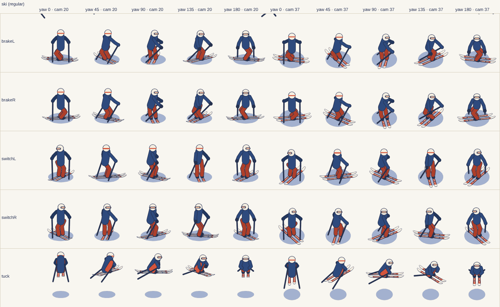
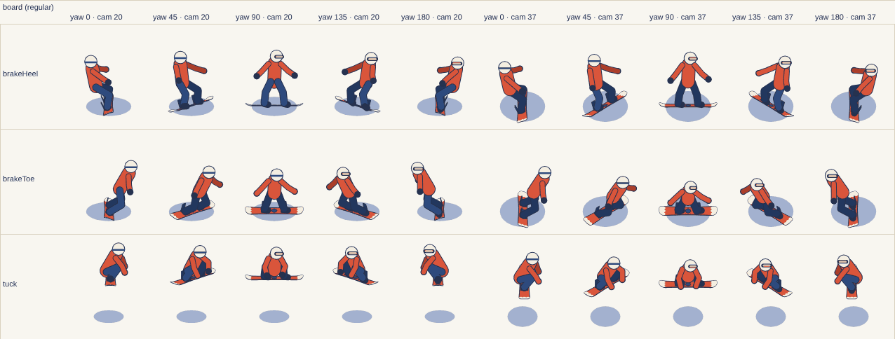
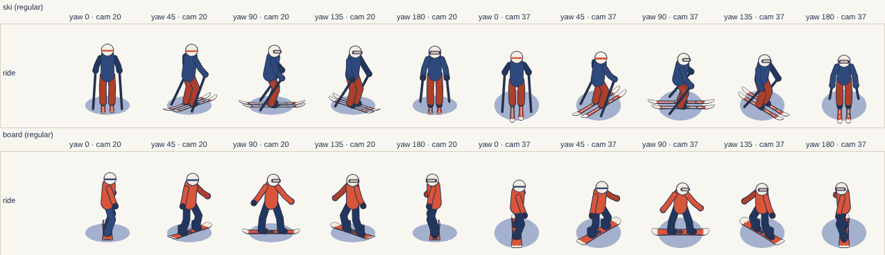
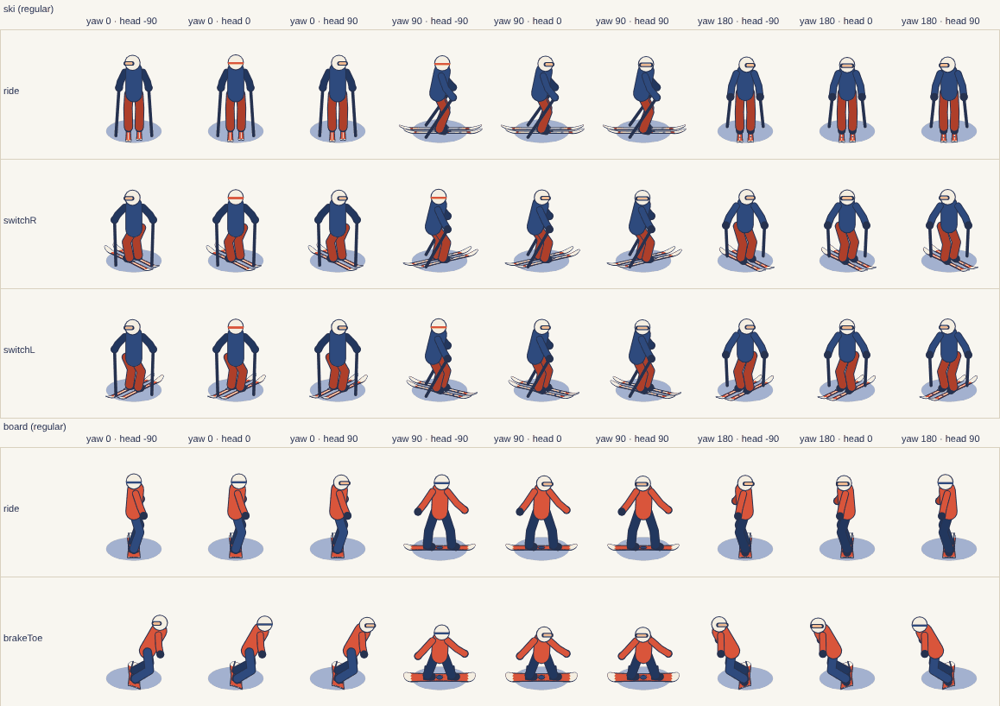
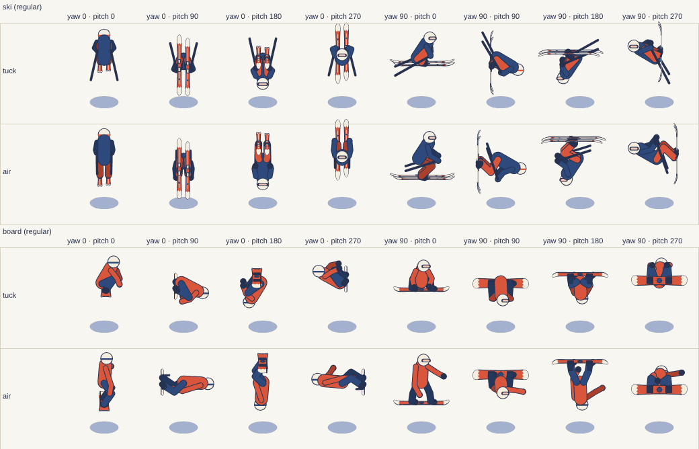
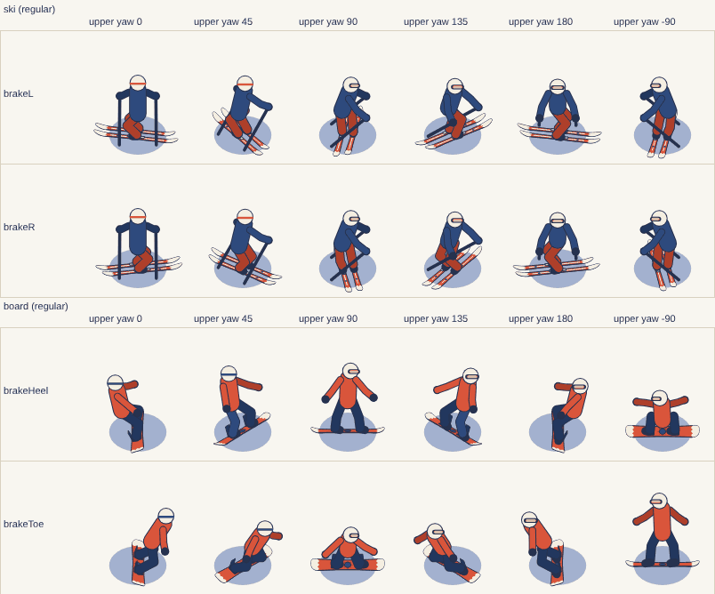

# Hanga Dawn art spec v1.4.0

`art/gresca-hanga-spec.js` goes from v1.3.0 to v1.4.0. The change is **additive**: a call that uses none of the new
options or state fields gives exactly the v1.3 result. `test/hanga-v14.test.js` checks this against the v1.3 module,
kept as `test/fixtures/hanga-spec-v1.3.0.cjs`. The spec is now written in this repo (see `AGENTS.md`). The copy on
the claude.ai design canvas "Gresca Rider Style Prototypes" (`project/data/gresca-hanga-spec.js`) is still v1.3.0, so
it is now out of date and must be copied again from the repo before anyone designs against it.

## What changed and why

| Feedback | Problem | v1.4 |
|---|---|---|
| **F1** player sizing | `projectRider` used a fixed 20° camera pitch, but the terrain camera looks down about 37° plus the slope tilt. The rider was seen from the side while the ground was seen from above, which gave the "sticker" look and stilt legs. The game also drew the rider at 0.55 of true size (`RIDER_SCALE`). | `options.cameraPitchDeg` takes the real camera pitch each frame. New `rider.scale` (draw scale 1, with framing left to the camera) and `camera.riderPitch` guidance. The terrain note no longer mentions "RSC .55". |
| **F5** braking turns the equipment, not the rider | There was no way to turn the skis or board without turning the whole body. | `options.twistDeg` turns the lower body and equipment relative to the upper body. New brake poses: ski `brakeL` / `brakeR` (hockey stop) and board `brakeHeel` / `brakeToe` (skid stops). |
| **F6** natural movement | Edge-driven lean and unweighting belong in RiderAnim. | No new pose. `rider.rotations.lean` sets out the conventions for twist, lean and unweighting that RiderAnim should follow. |
| **F7** ski fakie | The face vector was fixed, so the head could not look over a shoulder. | `options.headYawDeg` turns the head **and the face vector**, so the goggles move with it. New poses `switchL` / `switchR`: shoulders open 35°, head 90° over that shoulder, weight on the tails. |
| **F3** flips | There was no tuck and no way to pitch the rider. | `options.bodyPitchDeg` flips the whole rider about its own left–right axis (owner decision: skis about x, the board about its long axis). New `tuck` pose for both rigs (knees to the chest, hands on the shins). |

## API

```js
HANGA.projectRider(rig, pose, yaw, pitch, rollExtra, stance, options)
RiderAnim.project(state, yawDeg, pitchDeg, stance, options)   // passes options through unchanged
```

Every field of `options` is optional and in degrees. A field that is missing, null or not a finite number counts as
not given. The data is in `HANGA.rider.rotations`.

| Option | Meaning | Default |
|---|---|---|
| `cameraPitchDeg` | How far the camera looks down at the rider below the horizontal, + = down. Pass the pitch the terrain is drawn with this frame, slope tilt included. Replaces the positional `pitch`. | `pitch`, or else `camera.chasePitchDeg` (20) |
| `twistDeg` | How far the lower body and equipment are turned relative to the upper body. + is clockwise seen from above (toward the rider's right). Pivot: the vertical axis through the feet's ground point. With a twist, `yaw` is the heading of the upper body and the equipment heading is `yaw + twist`. | the pose's `twistDeg`, or else 0 |
| `headYawDeg` | How far the head is turned relative to the shoulders, with the same sign as twist. Pivot: the vertical axis through the neck. The face vector turns too, so the goggles or strap follow it. | the pose's `headYawDeg`, or else 0 |
| `bodyPitchDeg` | Flip angle about the rider's own left–right axis through `hipC`, as in a somersault. + is a front flip (chest and face first), − a backflip. Skis: rider-space x, so the head moves toward the heading. Board: the rider stands sideways, so the axis is the board's long axis (rider-space z) and + rolls toward the toe edge. Taken modulo 360. Equipment is included; the shadow is not. | 0 |

- **Options replace pose values; they do not add to them.** A brake or switch pose has its own twist and head yaw
  for when nothing else gives one. When the game gives its own values (for example the twist the simulation
  measures), they win.
- **Lower body** (`rotations.twist.lower`): for skis that is the ankles, knees, `hipL`/`hipR` and the ski joints; for a
  board it is the ankles, knees, `hipF`/`hipB`, `tail` and `nose`. `hipC`, the torso, arms, gloves, poles and head stay
  with the upper body.
- **Goofy:** twist and head yaw are given in the regular-stance frame and mirrored with the joints, so a value means the
  same thing relative to the board's nose in either stance. Body pitch is applied after the mirror; a goofy rider also
  faces +x, so + is a front flip (toward the toe edge on a board) in both stances.
- **Order:** pose joints (with the goofy mirror), then twist, then head yaw, then body pitch, then the v1.3 projection
  (roll + rollExtra, lift, yaw, camera pitch). Equipment shape offsets (v across, h up) are added before twist and
  pitch, so skis and the board keep their shape when they turn or flip.
- **Draw order in a flip:** while the body pitch is between 45° and 315°, a ski or the board that is more than 0.1 m
  nearer the camera than the torso is drawn after the body (`rotations.bodyPitch.equipInFront`), so its base covers
  the rider. At any other pitch the equipment stays under the body, as in v1.3.

### `HANGA.poseFor` state fields (all optional)

| Field | Values | Picks |
|---|---|---|
| `flipping` | true while a flip is under way (only when `airborne`) | `tuck` instead of `air` |
| `brakeSide` | with `braking`. Skis: `'left'` / `'right'`, the way the ski tips turn. Board: `'heel'` / `'toe'` | `brakeL` / `brakeR`, `brakeHeel` / `brakeToe`. A missing or other value keeps `crouch` |
| `isSwitch` | skis riding backwards (a board rides switch as the other stance) | `switchL` / `switchR` in place of `ride` and the carves |
| `lookSide` | `'left'` / `'right'` (default), the shoulder a switch skier looks over | `switchL` / `switchR` |

Priority is the same as in v1.3, with the new poses slotted in: wipeout, grind, air/tuck, land, brake/crouch, switch,
ride/carve. The test checks a grid of 3,456 v1.3 inputs and gets the same pose as v1.3 for every one.

### Blend timings (`rider.timing.into`)

| Pose | Blend in (s) | Notes |
|---|---|---|
| `brakeL`, `brakeR`, `brakeHeel`, `brakeToe` | 0.10 | Faster than `defaultBlend` (0.12), so a stop shows at once |
| `switchL`, `switchR` | 0.25 | The shoulders open and the head comes round together |
| `tuck` | 0.10 | `timing.after.tuck = 'air'` when the flip ends. `bodyPitchDeg` is never blended: it is the sim's flip angle |

`timing.angles`: blend a pose's `twistDeg` and `headYawDeg` as angles, the short way round, over the same time as its
joints.

## New poses

Offsets are in metres, in rider space, added to `rider.joints` as for every pose: x across (+ is the rider's right,
or the toe side on a board), y up, z forward. Lower-body offsets are in the equipment's frame, before twist.

| Rig | Pose | roll / lift | twist / head yaw | Joint offsets, in short |
|---|---|---|---|---|
| ski | `brakeL` | 0 / 0 | −80 / 0 | Hips 0.22 m lower; hips and knees 0.07–0.08 m toward the uphill side (ski-space −x); `hipC` 0.08 m back up the hill; upper body 0.24 m lower, still facing down the fall line; hands forward and a little wide |
| ski | `brakeR` | 0 / 0 | +80 / 0 | Mirror of `brakeL`: hips and knees toward +x |
| ski | `switchL` | 0 / 0 | +35 / −90 | Hips 0.10 m lower and 0.10 m toward the tails; knees 0.04 m back; upper body 0.10 m lower and 0.08 m back; hands wide and back for balance |
| ski | `switchR` | 0 / 0 | −35 / +90 | As `switchL`, looking over the right shoulder |
| ski | `tuck` | 0 / 0.5 | 0 / 0 | Ankles and skis up 0.66 m, knees up 0.67 m to chest height; hips 0.08 m back; neck and head down 0.12–0.14 m and forward 0.10–0.15 m; hands on the shins; poles trail back and up |
| board | `brakeHeel` | +22 / 0 | 0 / 0 | Hips 0.20 m lower and 0.10 m over the heels; upper body 0.20 m lower; arms forward over the toes |
| board | `brakeToe` | −20 / 0 | 0 / −45 | Knees 0.10 m and hips 0.06 m over the toes; upper body 0.16 m lower and 0.10 m forward; head turned 45° to look down the hill over the lead shoulder |
| board | `tuck` | 0 / 0.5 | 0 / 0 | Board and ankles up 0.62 m, knees up 0.58 m and 0.17 m out over the toes; upper body folds 0.16 m forward; hands on the shins |

## Migration notes for the game

- **S4 (look, camera, render), F1:** pass the camera's real look-down at the rider each frame:
  `riderAnim.project(anim, yaw, null, stance, { cameraPitchDeg })`. Set `RIDER_SCALE` (`src/core/config.js`) to 1, so the
  rider has the same pixels per metre as the ground under it, and frame the rider by moving the camera (distance,
  height, field of view) rather than by scaling it. Through P4 this goes through `Look.rider.project`.
- **S3 (rider animation):**
  - Body twist and F5 brake: pass `twistDeg` = equipment heading − upper-body heading, and `yaw` = upper-body heading
    − camera heading. Choose `brakeSide` from the sign of the twist (skis) or from the edge (board).
  - F6: lean is roll (rollExtra or the live pose's roll); unweighting is a joint offset; counter-rotation is twist
    (`rotations.lean`).
  - F7 fakie: `isSwitch` and `lookSide` from the downhill side, plus `headYawDeg` 80–100° (`rotations.headYaw.fakieDeg`).
  - F3: `flipping` while in a flip, and `bodyPitchDeg` = the sim's flip angle each frame.
  - RiderAnim's live pose has no twist or head yaw of its own. Blend the target pose's `twistDeg` / `headYawDeg` in
    RiderAnim (see `timing.angles`) and pass the result as options.
- **S2 (sim):** nothing is required from the spec. The `RiderState` fields from B2b (boardHeading, travelHeading,
  flipRot, isSwitch) map straight onto these options.
- Until S3 and S4 pass the options, the game draws exactly as it does today.

## Contact sheets

The sheets are drawn with `tools/rider-sheet.html` (serve the repo root over http). It uses the game's own
`drawRider` from `src/view/rider-draw.js`.

- New poses, ski, at yaw 0/45/90/135/180 and camera pitch 20° and 37°: 
- New poses, board: 
- Ride at camera pitch 20° (v1.3) and 37°: 
- Head yaw −90/0/+90 at yaw 0/90/180: 
- Body pitch 0/90/180/270, tuck and air: 
- Brake poses at camera pitch 37° for several upper-body yaws: 
